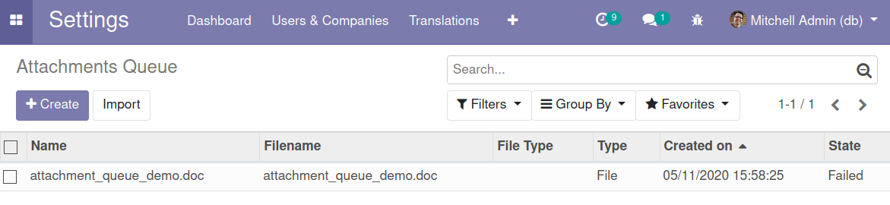
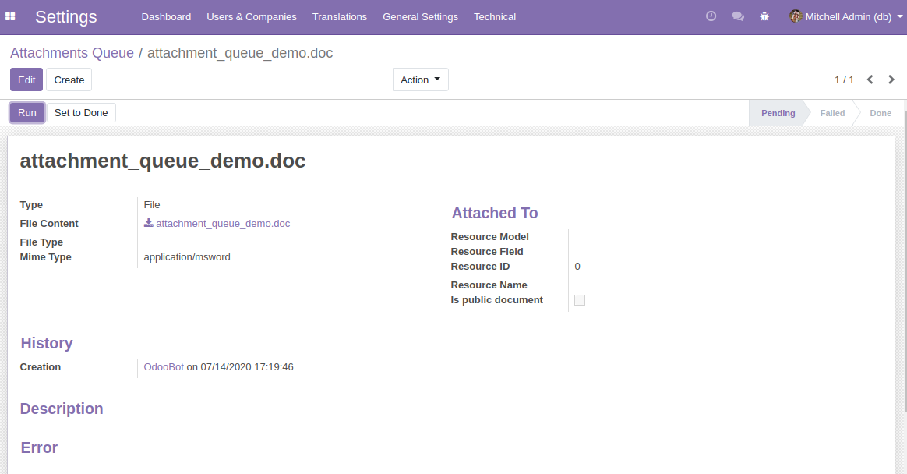

Go the menu Settings \> Technical \> Database Structure \> Attachments
Queue

You can create / see standard attachments with additional fields

Configure the batch limit for attachments that can be sync by the cron
task at a go:

Settings \> Technical \> System parameters \>
attachment_queue_cron_batch_limit

This module can be used in combination with attachment_synchronize to
control file processing workflow

**Failure management**

Each attachment is processed by a job. An attachment is flagged as *Failed* (and
an alert is sent to the *Failure Emails*) only when its job definitively fails:
a retryable error postpones the job and leaves the attachment *Pending* until
the last attempt is reached. A cancelled job also flags its attachment as
*Failed*, since no job is left to process it.

